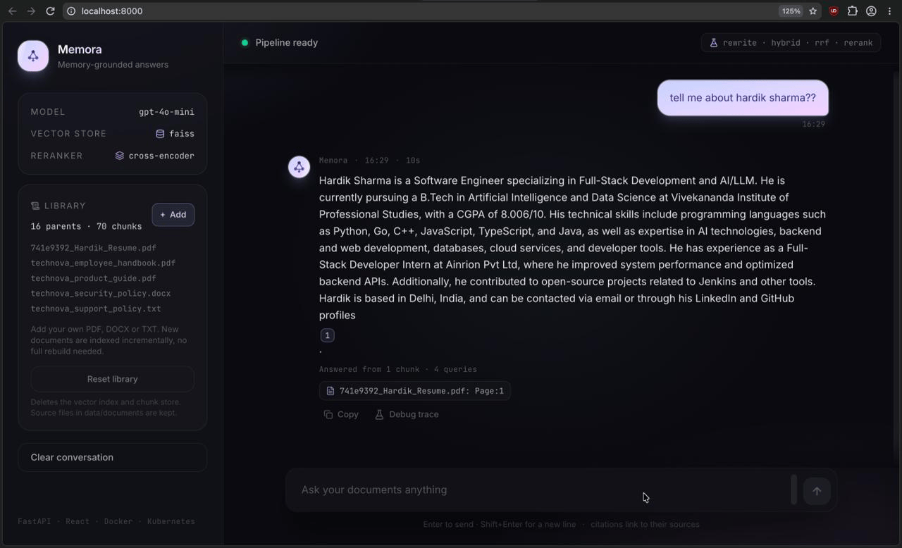
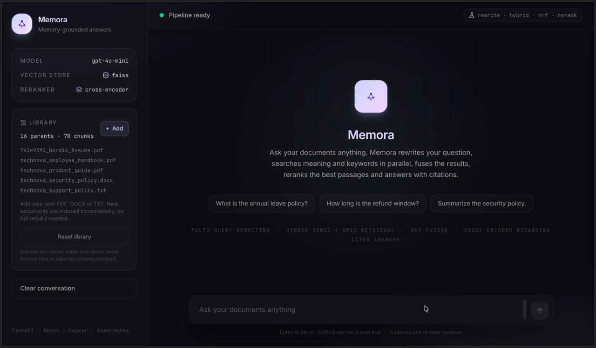
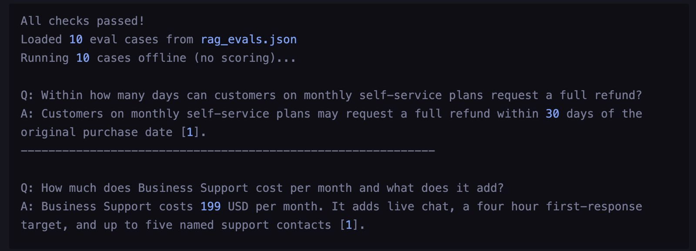
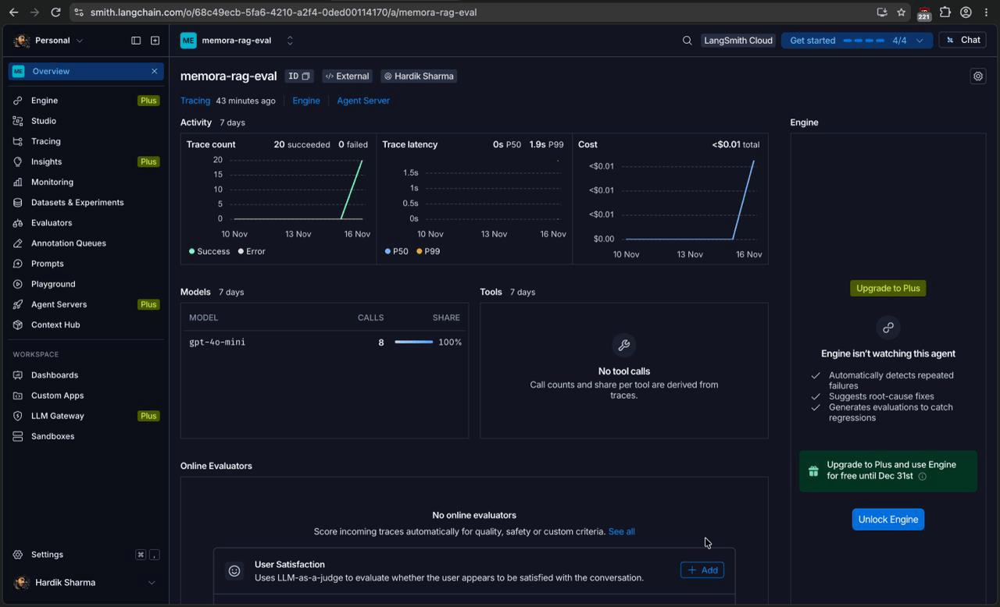
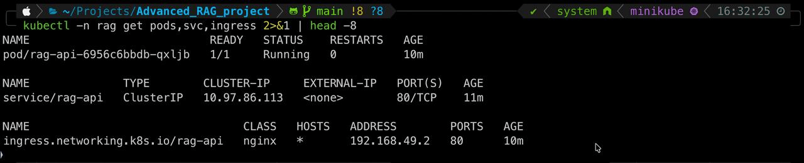

# Memora — Advanced RAG Pipeline

A production-grade Retrieval-Augmented Generation system with multi-format document ingestion, hierarchical parent-child chunking, multi-query rewriting, hybrid dense/sparse retrieval with Reciprocal Rank Fusion, cross-encoder reranking, and cited, streamed answers through a custom React console — packaged as a single Docker image, delivered by a GitHub Actions CI/CD pipeline, and evaluated end to end with LangSmith.

<p align="center">
  
</p>

---

## Why: the RAG quality problem

Standard RAG architectures suffer from a fundamental trade-off:

- **Lost context** — small chunks produce sharp embeddings for search, but lack the surrounding context the LLM needs for nuanced answers.
- **Diluted retrieval** — large chunks carry rich context, but their embeddings average out specifics, hurting search precision.
- **Vocabulary mismatch** — users say "time off" while the document says "annual leave"; single-query semantic search misses exact identifiers like "TN-SUP-2024".
- **Unverified answers** — retrieval always returns *something*, and without scoring, filtering and citations, the LLM happily invents around weak context.

Memora attacks all four at once.

## Architecture

```
 Ingestion                Indexing                 Query time
┌──────────────┐   ┌──────────────────────┐   ┌──────────────────────────────────────────┐
│ PDF/DOCX/TXT │   │ parent 1600c /       │   │ question ─► multi-query rewrite (LLM)    │
│ load → clean │──►│ child 400c chunks    │──►│   ├─► FAISS dense search (per query)     │
│ metadata +   │   │ FAISS or Pinecone    │   │   ├─► BM25 sparse search (per query)     │
│ section heads│   │ doc_store.json       │   │   └─► RRF fusion (1/(60+rank))           │
└──────────────┘   └──────────────────────┘   │        ─► recover parent chunks          │
                                              │        ─► cross-encoder rerank + filter  │
                                              │        ─► context budget (MAX_CONTEXT)   │
                                              │        ─► gpt-4o-mini, streamed, cited   │
                                              └──────────────────────────────────────────┘
```

### Pipeline stages in depth

1. **Multi-format ingestion** (`src/ingestion.py`) — PDF, DOCX and TXT loaders; text cleaning (dehyphenation, whitespace normalization); metadata enrichment (filename, page numbers, doc type); section-heading detection so citations can read *"Section: Password Policy"*.
2. **Hierarchical parent-child chunking** (`src/chunking.py`) — documents split into large parent chunks (1600 chars) for LLM context and small child chunks (400 chars) for search precision, linked by deterministic `parent_id`s. Search hits children; generation reads parents. Deterministic IDs make incremental indexing idempotent.
3. **Dual vector store** (`src/indexing.py`) — FAISS locally (zero account setup, index persisted in `vectorstore/faiss/`) or Pinecone in the cloud. The whole store can be rebuilt from scratch or updated **incrementally** — new files are chunked and embedded without re-embedding the library; identical chunks are skipped by `chunk_id` (saves API spend). For containerized single-replica deploys the FAISS index is **baked into the image at build time**.
4. **Multi-query rewriting** (`src/retrieval.py`) — an LLM expands the question into N paraphrases and resolves conversational references ("does *it* apply…?" → "does the refund policy apply…?"), using the session history. The original question is always kept, so the pipeline degrades gracefully if the rewrite call fails.
5. **Hybrid retrieval** — every query runs through *both* FAISS (semantic) and BM25 (exact term matching — model codes, policy names, "SOC 2"), catching meaning *and* identifiers.
6. **Reciprocal Rank Fusion** — result lists are merged with RRF: each document scores `1 / (60 + rank)` per list it appears in, summed. Chunks multiple searches agree on rise to the top; duplicates collapse.
7. **Parent recovery** — matched child chunks are replaced by their parents (deduplicated), so the LLM always reads full context, never orphan fragments.
8. **Cross-encoder reranking** (`src/reranking.py`) — `ms-marco-MiniLM-L-6-v2` scores every (query, parent) pair jointly (meaning-aware, unlike embeddings); a graceful keyword-overlap fallback keeps the pipeline alive if the model can't load. Each score lands in `rerank_score` metadata.
9. **Context refinement** (`src/refinement.py`) — drops chunks below `MIN_RERANK_SCORE` (retrieval always returns *something*; weak chunks invite hallucination), enforces a character budget (`MAX_CONTEXT_CHARS`), and formats numbered, source-labelled blocks — the numbering the model cites.
10. **Answer generation with memory** (`src/rag_pipeline.py`, `src/memory.py`) — a strict system prompt (context-only answers, cite `[1]`-style sources, admit when the docs don't cover it), a sliding conversation window (`MEMORY_WINDOW`) for natural follow-ups, and full streaming token-by-token over SSE.

### The UI (React + Vite + Tailwind)

- Token-by-token **SSE streaming** with a live caret and stop button
- **Citation chips** — every `[n]` in an answer links to the actual chunk it came from (hover to preview)
- **Debug trace drawer** — per answer: generated queries, retrieved (RRF-fused), reranked, and final context, each with rerank scores
- **Document library** — upload PDF/DOCX/TXT from the sidebar; ingestion runs incrementally with per-file success/failure feedback; a two-step-confirmed *Reset library* wipes the index (source files kept)
- Per-answer stats (`Answered from 3 chunks · 4 queries · 2.4s`), markdown rendering (lists, code, bold), copy-to-clipboard, smart autoscroll, pastel light theme with an animated brand mark

<p align="center">
  
</p>

---

## Project structure

```
.
├── app/                        # API layer (thin — no RAG logic here)
│   ├── main.py                 # FastAPI app, CORS, static UI mount
│   ├── api/routes.py           # /ask (JSON), /ask/stream (SSE), /documents, /history
│   ├── api/schemas.py          # Pydantic request/response models
│   ├── state.py                # lazy pipeline cache + per-session memory
│   ├── stages.py               # shared orchestration (JSON + SSE paths)
│   └── tests/                  # pytest suite for the API
├── src/                        # RAG core — pure Python, framework-agnostic
│   ├── ingestion.py            # loaders, cleaning, metadata, sections
│   ├── chunking.py             # parent/child splitting, lookup maps
│   ├── indexing.py             # FAISS/Pinecone, incremental updates, doc store
│   ├── retrieval.py            # query rewriting, hybrid search, RRF, parents
│   ├── reranking.py            # cross-encoder + keyword fallback
│   ├── refinement.py           # threshold filter, budget, prompt formatting
│   ├── memory.py               # sliding-window chat history
│   └── rag_pipeline.py         # end-to-end orchestrator
├── frontend/                   # React + Vite + TypeScript + Tailwind
│   └── src/components/         # ChatWindow, ChatMessage, Sidebar, DebugDrawer…
├── scripts/
│   ├── build_index.py          # CLI index build
│   ├── generate_sample_documents.py
│   └── evaluate.py             # LangSmith evaluation runner (offline + online)
├── data/
│   ├── documents/              # sample TechNova corpus (gitignored uploads)
│   └── evaluation/rag_evals.json  # 10 gold QA cases incl. unanswerable probe
├── k8s/                        # namespace, deployment, service, ingress,
│                               # configmap, secret template, HPA
├── .github/workflows/
│   ├── ci.yml                  # PRs: lint → tests → frontend build → docker build
│   ├── cd.yml                  # main: index → GHCR push → kubectl deploy
│   └── eval.yml                # manual dispatch: full LangSmith evaluation
├── Dockerfile                  # multi-stage: node build → python serve
├── docs/screenshots/           # deployment + evaluation proof
└── config.py                   # single source of configuration
```

---

## Getting started (local, no cluster)

### 1. Prerequisites
- Python 3.12+, Node 20+, Docker (for the container path)
- An OpenAI API key

### 2. Environment

```bash
git clone https://github.com/Hardik180704/memora.git
cd memora
python -m venv .venv && source .venv/bin/activate
pip install -r requirements.txt

cp .env.example .env   # then set OPENAI_API_KEY
```

Key settings (all in `.env`): `VECTOR_DB=faiss|pinecone`, `RERANKER=cross-encoder|simple`, chunk sizes, retrieval top-k, `MIN_RERANK_SCORE`, context budget, memory window, LangSmith keys.

### 3. Build the index

```bash
python scripts/build_index.py
```

### 4. Run

```bash
# single server (API + built UI on :8000)
uvicorn app.main:app --port 8000

# or dev mode with hot reload
uvicorn app.main:app --reload          # terminal 1
npm run dev --prefix frontend          # terminal 2 → :5173 (proxies /api)
```

Open **http://localhost:8000**, upload your own PDF/DOCX/TXT from the sidebar, and ask.

Tests and lint (what CI runs):

```bash
pytest app/tests -q
ruff check src app scripts config.py llm_client.py
```

---

## Evaluation (LangSmith)

Two modes from one runner, `scripts/evaluate.py`:

| Command | What it does | Cost |
| --- | --- | --- |
| `python scripts/evaluate.py --offline` | runs the real pipeline over all 10 cases, prints answers | tokens for answers only |
| `python scripts/evaluate.py` | syncs the gold set to LangSmith, runs the pipeline, scores with two LLM judges, publishes an experiment | + judge calls |
| `python scripts/evaluate.py --limit 3` | first N cases only | cheaper |
| Actions tab → *RAG Evaluation* | the same, on GitHub runners | manual dispatch only |

### The gold dataset

`data/evaluation/rag_evals.json` holds 10 QA cases **grounded in the actual sample corpus** (refund windows, support-plan pricing, priority response targets, learning budget, expense cut-offs, office facts) plus one deliberate **unanswerable probe** ("maximum annual cloud infrastructure spend?") whose reference answer is a refusal — a hallucination tripwire that scores whether the pipeline admits gaps instead of inventing.

### The judges

- **`correctness`** (reference-based) — grades the produced answer against the gold reference: 0 wrong / 1 partial / 2 correct. Equivalent honest refusals pass when the reference itself declines.
- **`groundedness`** (reference-free) — grades the answer **only against the full text of the chunks that reached the prompt** (not truncated previews): 2 all claims supported / 1 minor unsupported details / 0 invented facts.

The pair is diagnostic: `groundedness=2, correctness=0` → faithful answer to the wrong retrieval; `correctness=2, groundedness=0` → right answer with unsupported claims.

### Running results

Latest offline run — 9/10 answerable cases correct with citations; the unanswerable probe correctly declined:

<p align="center">
  
</p>

Online runs publish every experiment to LangSmith with full traces (question → query rewriting → retrieval → answer → judge verdicts):

<p align="center">
  
</p>

**Reading the scores:** occasional 1s are signal, not noise. The regression alarm is three consecutive 0s on answerable cases — that's the failure mode this pipeline exists to catch after prompt, model, or retrieval changes.

A **corpus guard** refuses to evaluate when the index doesn't contain the TechNova corpus (scores would be meaningless), overridable with `--force`.

---

## CI/CD and Kubernetes

### Pipeline

| Workflow | Trigger | Jobs |
| --- | --- | --- |
| **CI** (`ci.yml`) | every PR to `main` | ruff → pytest → frontend typecheck+build → docker build (no push, GHA cache) |
| **CD** (`cd.yml`) | every push to `main` / `v*` tags | build vector index → build & push image to GHCR (`:sha`, `:latest`) → `kubectl apply` manifests → `set image` → `rollout status` (5 min gate) |
| **Eval** (`eval.yml`) | manual dispatch only | full LangSmith evaluation (manual because LLM evals cost tokens and are too unstable to gate merges) |

### Image design

Single **multi-stage Dockerfile**: `node:20-alpine` builds the React app → `python:3.12-slim` installs CPU-only torch (`--extra-index-url …/whl/cpu` avoids the ~2 GB CUDA pull) and serves API + static UI on one port, as a non-root user with a healthcheck. The FAISS index is baked in at build time (`cd.yml` runs `build_index.py` before the docker build), so a deployed pod answers immediately — the right trade-off for single-replica FAISS mode; multi-replica deployments switch `VECTOR_DB=pinecone` in the configmap.

### Kubernetes manifests (`k8s/`)

- **namespace** (`rag`), **configmap** (all pipeline settings), **secret** (template only — created imperatively so keys never hit git)
- **deployment** — readiness/liveness probes on `/api/health`, resource requests/limits, GHCR `imagePullSecrets`
- **service** (ClusterIP :80) + **ingress** (nginx class, SSE-tuned: buffering off, 300s read timeout)
- **hpa** — 1→5 replicas at 75% CPU

### Verified on minikube

Deployed to a local Kubernetes cluster and verified end to end — pod healthy, probes green, and the full retrieval → rerank → answer chain executing inside the cluster:

| Pod, service and ingress | Cited answer generated inside the cluster |
| --- | --- |
|  |  |

Reproduce locally:

```bash
minikube start --driver=docker --cpus=2 --memory=4096 --disk-size=20g
minikube addons enable ingress
docker build -t memora:local . && minikube image load memora:local

kubectl apply -f k8s/namespace.yaml
kubectl -n rag create secret generic rag-secrets \
  --from-literal=OPENAI_API_KEY=sk-your-real-key
kubectl apply -f k8s/configmap.yaml -f k8s/deployment.yaml \
  -f k8s/service.yaml -f k8s/ingress.yaml -f k8s/hpa.yaml

kubectl -n rag set image deployment/rag-api api=memora:local
kubectl -n rag rollout status deployment/rag-api --timeout=300s
kubectl -n rag port-forward svc/rag-api 8000:80   # → http://localhost:8000
```

For the full remote story (Actions deploying to a real cluster), set two repo
secrets — `KUBECONFIG` (base64 kubeconfig of a cluster reachable from GitHub
runners, e.g. kind on an EC2 spot instance) and `OPENAI_API_KEY` — then every
push to `main` ships automatically. One known trade-off is documented in the
README history: FAISS mode is single-replica; scale-out switches to Pinecone
via the configmap.

---

## API reference

| Method | Path | Purpose |
| --- | --- | --- |
| `POST` | `/api/ask` | full pipeline in one JSON response (answer, sources, debug) |
| `POST` | `/api/ask/stream` | SSE stream: `status` → `sources` → `token`… → `done` |
| `GET` | `/api/documents` | index summary (parents, chunks, files) |
| `POST` | `/api/documents` | multipart upload, incremental ingestion |
| `DELETE` | `/api/documents?confirm=true` | wipe the index (guarded, source files kept) |
| `GET` | `/api/status` | live pipeline settings (model, vector store, reranker) |
| `GET/DELETE` | `/api/history` | clear one session's conversation |
| `GET` | `/api/health` | liveness probe |

Interactive docs at `/api/docs` (Swagger) when the server runs.

---

## License

This project is licensed under the MIT License.
